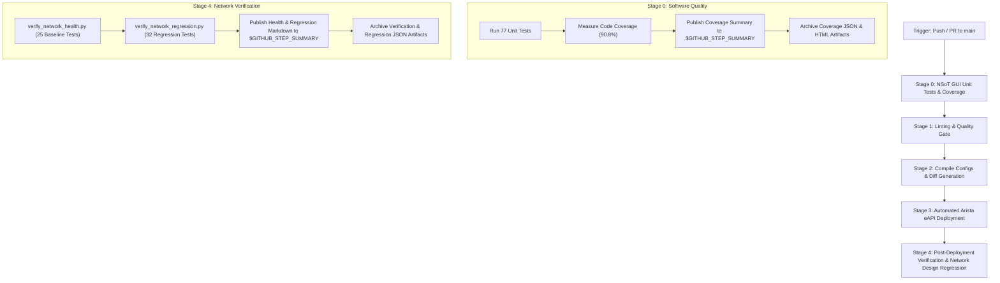

# 🧪 Comprehensive Test & Verification Guide
## NSoT GUI Unit Tests & Network Design Regression Test Suite

This document provides a complete reference for all automated tests implemented for the **Network Source of Truth (NSoT) GUI** and the **Containerlab Network Design Regression Test Suite**, including their integration into the GitHub Actions NetDevOps CI/CD workflow, code coverage measurements, and specific Pass/Fail criteria.

---

## 📑 Table of Contents
1. [Test Suite Architecture Overview](#1-test-suite-architecture-overview)
2. [NSoT GUI Unit Tests Suite (77 Tests)](#2-nsot-gui-unit-tests-suite-77-tests)
   - [2.1 Device Model Tests (Positive & Negative)](#21-device-model-tests)
   - [2.2 Golden Configuration Model Tests](#22-golden-configuration-model-tests)
   - [2.3 Template & Maintenance Log Model Tests](#23-template--maintenance-log-model-tests)
   - [2.4 Dashboard Views & Search/Filter Tests](#24-dashboard-views--searchfilter-tests)
   - [2.5 Device CRUD View Tests](#25-device-crud-view-tests)
   - [2.6 Config Pull & Golden Snapshot View Tests](#26-config-pull--golden-snapshot-view-tests)
   - [2.7 Jinja2 Template & Change Studio View Tests](#27-jinja2-template--change-studio-view-tests)
   - [2.8 REST API & Command Execution View Tests](#28-rest-api--command-execution-view-tests)
   - [2.9 Maintenance, DR Failover & CI/CD Diagnostic Tests](#29-maintenance-dr-failover--cicd-diagnostic-tests)
   - [2.10 Core Logic & Health Extended Tests](#210-core-logic--health-extended-tests)
3. [Network Design Regression Test Suite (32 Tests)](#3-network-design-regression-test-suite-32-tests)
   - [3.1 Data Plane IP Reachability Assertions](#31-data-plane-ip-reachability-assertions)
   - [3.2 Control Plane Routing Information Base (RIB) Assertions](#32-control-plane-routing-information-base-rib-assertions)
   - [3.3 Protocol Adjacencies & High Availability (HA) Assertions](#33-protocol-adjacencies--high-availability-ha-assertions)
4. [Code Coverage Analysis & Metrics](#4-code-coverage-analysis--metrics)
5. [GitHub Actions CI/CD Pipeline Integration](#5-github-actions-cicd-pipeline-integration)
6. [Local Execution Instructions](#6-local-execution-instructions)

---

## 1. Test Suite Architecture Overview

The testing framework employs a defense-in-depth verification strategy spanning both software application logic (NSoT GUI) and live network infrastructure behavior (Containerlab multi-vendor topology):

```
+---------------------------------------------------------------------------------------------------+
|                                 NetDevOps CI/CD Quality Gate Pipeline                             |
+---------------------------------------------------------------------------------------------------+
       |
       v
+-------------------------------+       +-------------------------------+
|  Stage 0: NSoT GUI Unit Tests | ----> |   Stage 1: Lint & Validate    |
|   (Django Test Runner + Cov)  |       |  (YAML, Jinja2, Secret Scans) |
+-------------------------------+       +-------------------------------+
       |                                                |
       v                                                v
+-------------------------------+       +-------------------------------+
| Stage 2: Compile & Diff Config| ----> | Stage 3: Automated Deployment |
|  (Git, Jinja2, Vault, PyEAPI) |       | (Arista eAPI Staggered Push)  |
+-------------------------------+       +-------------------------------+
                                                        |
                                                        v
                                        +-------------------------------+
                                        | Stage 4: Post-Deploy Health   |
                                        | & Network Regression Suite    |
                                        | (32 Positive & Negative Tests)|
                                        +-------------------------------+
```

---

## 2. NSoT GUI Unit Tests Suite (77 Tests)

Implemented in `nsot_project/automation/tests.py`, this test suite uses Django's isolated test database runner and `unittest.mock` to validate models, views, API endpoints, error handling, and maintenance workflows.

### 2.1 Device Model Tests
| Test Method | Type | Target | Description | Pass / Fail Criteria |
| :--- | :---: | :--- | :--- | :--- |
| `test_device_creation_positive` | **Positive** | `Device` Model | Creates valid router model and checks field assignments. | **Pass**: Model saves to DB with correct `name='R1'`, `device_type='router'`, `vendor='arista'`, `status='Online'`. <br>**Fail**: Model validation error or incorrect attribute retrieval. |
| `test_device_default_values_positive` | **Positive** | `Device` Model | Verifies model default field values when optional parameters are omitted. | **Pass**: `vendor` defaults to `'arista'`, `status` defaults to `'Unknown'`, `tier` defaults to `'access'`. <br>**Fail**: Defaults missing or set to `None`. |
| `test_device_unique_name_constraint_negative` | **Negative** | `Device` Model | Attempts to insert duplicate device name `'R1'`. | **Pass**: Database raises `django.db.utils.IntegrityError` upon `save()`. <br>**Fail**: Duplicate device name allowed into database without constraint violation. |
| `test_device_str_representation_positive` | **Positive** | `Device.__str__` | Tests string rendering of device instance. | **Pass**: Returns string matching `"R1 (router - arista)"`. <br>**Fail**: String format mismatch. |

### 2.2 Golden Configuration Model Tests
| Test Method | Type | Target | Description | Pass / Fail Criteria |
| :--- | :---: | :--- | :--- | :--- |
| `test_golden_config_creation_positive` | **Positive** | `GoldenConfig` Model | Creates golden configuration version record linked to device. | **Pass**: Record created with foreign key to R1, valid version string `'v1.0.0'`, and config text. <br>**Fail**: Foreign key mismatch or failed insertion. |
| `test_golden_config_cascade_delete_positive` | **Positive** | `GoldenConfig` Model | Tests database cascade deletion when parent device is removed. | **Pass**: Deleting `Device` cascades to delete associated `GoldenConfig` instances (`GoldenConfig.count() == 0`). <br>**Fail**: Orphan records remain or deletion blocked. |
| `test_golden_config_null_device_negative` | **Negative** | `GoldenConfig` Model | Attempts to create golden config without required parent device. | **Pass**: Database raises `IntegrityError` due to NOT NULL constraint on `device_id`. <br>**Fail**: GoldenConfig record saved without device foreign key. |

### 2.3 Template & Maintenance Log Model Tests
| Test Method | Type | Target | Description | Pass / Fail Criteria |
| :--- | :---: | :--- | :--- | :--- |
| `test_template_creation_positive` | **Positive** | `TemplateModel` | Verifies saving Jinja2 template file reference and content. | **Pass**: Model persists `name='r1_r2.j2'`, `vendor='arista'`, `tier='distribution'`. <br>**Fail**: Record creation failure. |
| `test_template_unique_name_negative` | **Negative** | `TemplateModel` | Enforces unique template name constraint in database. | **Pass**: Inserting duplicate template name raises `IntegrityError`. <br>**Fail**: Duplicate template name permitted. |
| `test_maintenance_log_creation_positive` | **Positive** | `MaintenanceLog` | Records disaster recovery audit trail entry. | **Pass**: Log entry saved with `stage`, `action`, `ping_status`, and timestamp. <br>**Fail**: Missing field error on save. |

### 2.4 Dashboard Views & Search/Filter Tests
| Test Method | Type | Target | Description | Pass / Fail Criteria |
| :--- | :---: | :--- | :--- | :--- |
| `test_dashboard_view_positive` | **Positive** | GET `/` | Renders dashboard view with device summary statistics. | **Pass**: HTTP 200, template `automation/dashboard.html` rendered, device count matches database. <br>**Fail**: Non-200 status or missing context variables. |
| `test_dashboard_filter_by_type_positive` | **Positive** | GET `/?type=router` | Filters dashboard device table by `device_type='router'`. | **Pass**: Response context contains only router devices (`R1`, `R2`), switch `S1` excluded. <br>**Fail**: Unfiltered or incorrect device list returned. |
| `test_dashboard_filter_by_vendor_positive` | **Positive** | GET `/?vendor=cisco_nxos` | Filters dashboard device table by `vendor='cisco_nxos'`. | **Pass**: Context contains only Cisco devices (`S1`), Arista devices excluded. <br>**Fail**: Cross-vendor contamination in query results. |
| `test_dashboard_search_positive` | **Positive** | GET `/?q=172.20.20.11` | Searches inventory by IP address substring. | **Pass**: Returns exact device matching management IP `172.20.20.11` (`R1`). <br>**Fail**: Empty response or incorrect device match. |
| `test_dashboard_search_negative_no_results` | **Negative** | GET `/?q=NON_EXISTENT` | Searches inventory with non-matching query string. | **Pass**: HTTP 200, context `devices` list is empty (`len(devices) == 0`). <br>**Fail**: Unexpected devices returned or 500 error. |

### 2.5 Device CRUD View Tests
| Test Method | Type | Target | Description | Pass / Fail Criteria |
| :--- | :---: | :--- | :--- | :--- |
| `test_add_device_get_positive` | **Positive** | GET `/devices/add/` | Renders add device form view. | **Pass**: HTTP 200, template `automation/device_form.html` used. <br>**Fail**: View fails to render. |
| `test_add_device_post_valid_positive` | **Positive** | POST `/devices/add/` | Submits valid form payload to create new device. | **Pass**: HTTP 302 redirect to dashboard, new device record created in database with input fields. <br>**Fail**: Form validation error or database failure. |
| `test_add_device_post_missing_name_negative` | **Negative** | POST `/devices/add/` | Submits form payload missing mandatory `name` field. | **Pass**: HTTP 200 (re-renders form with validation error), device not created. <br>**Fail**: 302 redirect or invalid device inserted. |
| `test_add_device_post_duplicate_name_negative` | **Negative** | POST `/devices/add/` | Submits form payload reusing existing device name `'R1'`. | **Pass**: Re-renders form displaying duplicate name error message, database unchanged. <br>**Fail**: Record overwritten or database error unhandled. |
| `test_edit_device_get_positive` | **Positive** | GET `/devices/1/edit/` | Renders edit form prepopulated with device attributes. | **Pass**: HTTP 200, form contains existing device `R1` data. <br>**Fail**: Non-200 status or wrong device loaded. |
| `test_edit_device_get_nonexistent_negative` | **Negative** | GET `/devices/999/edit/` | Requests edit form for non-existent device ID. | **Pass**: Returns HTTP 404 Not Found. <br>**Fail**: 200 or 500 error. |
| `test_edit_device_post_valid_positive` | **Positive** | POST `/devices/1/edit/` | Submits updated device metadata (tier, role, IP). | **Pass**: HTTP 302 redirect, database record updated with new values. <br>**Fail**: Updates not persisted to DB. |
| `test_delete_device_post_positive` | **Positive** | POST `/devices/1/delete/` | Deletes existing device via POST confirmation. | **Pass**: HTTP 302 redirect to dashboard, device deleted from DB (`Device.objects.filter(name='R1').count() == 0`). <br>**Fail**: Record still exists in database. |
| `test_delete_device_get_rejected_negative` | **Negative** | GET `/devices/1/delete/` | Requests deletion via insecure GET request. | **Pass**: HTTP 302 redirect without deleting device (safe mutation protection). <br>**Fail**: Device deleted via GET. |
| `test_delete_device_nonexistent_negative` | **Negative** | POST `/devices/999/delete/` | Attempts deletion of non-existent device ID. | **Pass**: Returns HTTP 404 Not Found. <br>**Fail**: 500 server crash. |
| `test_device_detail_view_positive` | **Positive** | GET `/devices/1/` | Displays full device details, running config, and diff history. | **Pass**: HTTP 200, context includes device instance, config tabs, and golden config list. <br>**Fail**: Missing context or 404. |
| `test_device_detail_view_nonexistent_negative` | **Negative** | GET `/devices/999/` | Requests details for non-existent device. | **Pass**: Returns HTTP 404 Not Found. <br>**Fail**: Uncaught DoesNotExist exception. |

### 2.6 Config Pull & Golden Snapshot View Tests
| Test Method | Type | Target | Description | Pass / Fail Criteria |
| :--- | :---: | :--- | :--- | :--- |
| `test_pull_live_config_eapi_success_positive` | **Positive** | POST `/devices/1/pull/` | Mocks Arista eAPI response to pull running configuration. | **Pass**: HTTP 302 redirect, `device.running_config` updated with pulled text, `last_config_pulled_at` timestamp set. <br>**Fail**: Config not updated in database. |
| `test_pull_live_config_eapi_failure_negative` | **Negative** | POST `/devices/1/pull/` | Simulates eAPI connection timeout / socket refusal. | **Pass**: HTTP 302 redirect with user-facing warning message, database retains previous config. <br>**Fail**: Unhandled exception or crashing view. |
| `test_pull_live_config_nonexistent_device_negative` | **Negative** | POST `/devices/999/pull/` | Pulls config for non-existent device ID. | **Pass**: Returns HTTP 404 Not Found. <br>**Fail**: Non-404 status. |
| `test_save_golden_config_positive` | **Positive** | POST `/devices/1/save-golden/` | Captures current running config as new versioned golden baseline. | **Pass**: HTTP 302 redirect, new `GoldenConfig` record created with timestamped version, saved to `golden_configs/` filesystem. <br>**Fail**: Record not created or missing file. |
| `test_save_golden_config_empty_negative` | **Negative** | POST `/devices/1/save-golden/` | Attempts to create golden snapshot when running config is empty. | **Pass**: HTTP 302 redirect with error message, no empty golden config created. <br>**Fail**: Empty golden config persisted. |
| `test_diff_view_positive` | **Positive** | GET `/devices/1/diff/` | Computes visual side-by-side unified diff between running and golden config. | **Pass**: HTTP 200, context contains `diff_output` string with unified diff additions/deletions. <br>**Fail**: Missing diff or template rendering error. |

### 2.7 Jinja2 Template & Change Studio View Tests
| Test Method | Type | Target | Description | Pass / Fail Criteria |
| :--- | :---: | :--- | :--- | :--- |
| `test_templates_list_view_positive` | **Positive** | GET `/templates/` | Lists all Jinja2 configuration templates in repository. | **Pass**: HTTP 200, lists templates from `Jinja2_templates_Arista/` and `Jinja2_templates_Cisco_NXOS/`. <br>**Fail**: Template listing empty or non-200 status. |
| `test_templates_list_filter_vendor_positive` | **Positive** | GET `/templates/?vendor=arista` | Filters template list by hardware vendor. | **Pass**: Returns only Arista templates, Cisco NX-OS templates filtered out. <br>**Fail**: Mixed vendor results. |
| `test_render_template_view_get_positive` | **Positive** | GET `/templates/render/?template=r1_r2.j2` | Loads template rendering studio with template content and sample YAML. | **Pass**: HTTP 200, template contents loaded into editor textarea. <br>**Fail**: Template file not found or non-200. |
| `test_render_template_post_valid_yaml_positive` | **Positive** | POST `/templates/render/` | Submits YAML data model to render Jinja2 configuration template. | **Pass**: HTTP 200, `rendered_output` context contains rendered device configuration text. <br>**Fail**: Template rendering error or syntax exception. |
| `test_render_template_post_invalid_yaml_negative` | **Negative** | POST `/templates/render/` | Submits malformed YAML syntax (unbalanced braces/tabs). | **Pass**: HTTP 200, context contains `error` describing YAML parse failure, `rendered_output` is empty. <br>**Fail**: Uncaught parser exception (500). |
| `test_render_template_nonexistent_template_negative` | **Negative** | GET `/templates/render/?template=missing.j2` | Requests rendering of non-existent template file. | **Pass**: HTTP 200 with error message or 404, gracefully handled. <br>**Fail**: Unhandled FileNotFoundError. |

### 2.8 REST API & Command Execution View Tests
| Test Method | Type | Target | Description | Pass / Fail Criteria |
| :--- | :---: | :--- | :--- | :--- |
| `test_api_devices_list_positive` | **Positive** | GET `/api/devices/` | JSON REST API endpoint returning full inventory list. | **Pass**: HTTP 200, `Content-Type: application/json`, returns JSON array of device objects with IDs, names, vendors, and IPs. <br>**Fail**: Non-JSON response or missing devices. |
| `test_web_console_view_positive` | **Positive** | GET `/console/` | Renders interactive network diagnostic console HUD. | **Pass**: HTTP 200, template `automation/console.html` rendered with device selector dropdown. <br>**Fail**: Non-200 response. |
| `test_api_device_exec_cmd_positive` | **Positive** | POST `/api/device/exec/` | Executes operational command (`show version`) on router via eAPI. | **Pass**: HTTP 200, JSON response `status='success'`, `output` contains command results. <br>**Fail**: Non-200 status or error in JSON. |
| `test_api_device_exec_cmd_get_negative` | **Negative** | GET `/api/device/exec/` | Invokes execution API using disallowed HTTP GET method. | **Pass**: Returns HTTP 405 Method Not Allowed. <br>**Fail**: 200 or 500 status. |
| `test_api_device_exec_cmd_empty_command_negative` | **Negative** | POST `/api/device/exec/` | Submits POST request with empty command string `""`. | **Pass**: Returns HTTP 400 Bad Request, JSON `status='error'`, message indicates command cannot be empty. <br>**Fail**: Command executed or 500 error. |
| `test_api_device_exec_cmd_eapi_failure_negative` | **Negative** | POST `/api/device/exec/` | Simulates eAPI communication failure on target router. | **Pass**: Returns HTTP 500 Internal Server Error, JSON `status='error'`, output contains error description. <br>**Fail**: View crash or false success. |
| `test_config_change_view_positive` | **Positive** | GET `/config/change/` | Renders Configuration Change Studio with live syntax checking. | **Pass**: HTTP 200, template `automation/config_change.html` rendered. <br>**Fail**: View fails to load. |
| `test_api_commit_and_pipeline_get_negative` | **Negative** | GET `/api/cicd/commit-change/` | Accesses commit endpoint via GET method. | **Pass**: Returns HTTP 405 Method Not Allowed. <br>**Fail**: Mutation executed via GET. |
| `test_api_commit_and_pipeline_empty_commands_negative` | **Negative** | POST `/api/cicd/commit-change/` | Submits commit request without configuration commands. | **Pass**: Returns HTTP 400 Bad Request. <br>**Fail**: Empty commit executed. |
| `test_api_commit_and_pipeline_success_positive` | **Positive** | POST `/api/cicd/commit-change/` | Applies commands via eAPI, pulls updated config, and creates Git commit. | **Pass**: HTTP 200, JSON `status='success'`, device config updated and Git commit recorded. <br>**Fail**: Non-200 status or unhandled error. |
| `test_api_commit_and_pipeline_eapi_failure_negative` | **Negative** | POST `/api/cicd/commit-change/` | Simulates device syntax error rejecting configuration push. | **Pass**: HTTP 500, JSON `status='error'`, `deploy_ready=False`, no invalid Git commit created. <br>**Fail**: False success or broken state. |

### 2.9 Maintenance, DR Failover & CI/CD Diagnostic Tests
| Test Method | Type | Target | Description | Pass / Fail Criteria |
| :--- | :---: | :--- | :--- | :--- |
| `test_maintenance_view_positive` | **Positive** | GET `/maintenance/` | Renders Disaster Recovery & Maintenance Mode dashboard. | **Pass**: HTTP 200, template `automation/maintenance.html` rendered with drain controls. <br>**Fail**: Non-200 status. |
| `test_maintenance_action_api_get_negative` | **Negative** | GET `/api/maintenance/action/` | Accesses maintenance mutation API via GET. | **Pass**: Returns HTTP 405 Method Not Allowed. <br>**Fail**: Action triggered via GET. |
| `test_maintenance_action_api_invalid_action_negative` | **Negative** | POST `/api/maintenance/action/` | Submits unknown action name `invalid_unknown_action`. | **Pass**: Returns HTTP 400 Bad Request, JSON `status='error'`. <br>**Fail**: 200 status or unexpected execution. |
| `test_cicd_view_positive` | **Positive** | GET `/cicd/` | Renders NetDevOps CI/CD dashboard view. | **Pass**: HTTP 200, template `automation/cicd_pipeline.html` rendered. <br>**Fail**: Non-200 status. |
| `test_api_run_cicd_positive` | **Positive** | POST `/api/cicd/run/` | Triggers background deployment pipeline execution. | **Pass**: HTTP 200, JSON response status is `'success'` or `'warning'`, includes stdout log. <br>**Fail**: Non-200 response or server crash. |
| `test_api_golden_audit_positive` | **Positive** | GET `/api/cicd/golden-audit/` | Invokes automated drift audit against golden baselines. | **Pass**: HTTP 200, JSON returns drift status per device. <br>**Fail**: Non-200 status or unparsed output. |
| `test_api_golden_audit_failure_negative` | **Negative** | GET `/api/cicd/golden-audit/` | Simulates audit script execution failure. | **Pass**: Returns HTTP 500, JSON `status='error'`. <br>**Fail**: False success reported. |
| `test_api_telemetry_positive` | **Positive** | GET `/api/cicd/telemetry/` | Queries live telemetry collector metrics. | **Pass**: HTTP 200, JSON `status='success'`, contains metrics dictionary. <br>**Fail**: Non-200 status. |
| `test_api_telemetry_failure_negative` | **Negative** | GET `/api/cicd/telemetry/` | Simulates telemetry collector subprocess timeout. | **Pass**: Returns HTTP 504 Gateway Timeout, JSON `status='error'`. <br>**Fail**: Unhandled TimeoutExpired crash. |
| `test_api_troubleshoot_positive` | **Positive** | GET `/api/cicd/troubleshoot/` | Invokes automated network diagnostic troubleshooting engine. | **Pass**: HTTP 200, JSON `status='success'`, returns diagnostic report with system health state. <br>**Fail**: Non-200 status. |
| `test_api_troubleshoot_failure_negative` | **Negative** | GET `/api/cicd/troubleshoot/` | Simulates diagnostic engine script error. | **Pass**: Returns HTTP 500, JSON `status='error'`. <br>**Fail**: Unhandled exception. |

### 2.10 Core Logic & Health Extended Tests
| Test Method | Type | Target | Description | Pass / Fail Criteria |
| :--- | :---: | :--- | :--- | :--- |
| `test_pull_live_config_arista_success_positive` | **Positive** | `pull_live_config_from_node` | Tests Arista eAPI response parsing helper. | **Pass**: Returns `(True, config_string)` with parsed config content. <br>**Fail**: Returns False or wrong text. |
| `test_pull_live_config_arista_exception_negative` | **Negative** | `pull_live_config_from_node` | Tests eAPI exception handling and fallback mechanism. | **Pass**: Returns `(False, error_message)` without raising unhandled exception. <br>**Fail**: Uncaught network socket error. |
| `test_pull_live_config_cisco_render_positive` | **Positive** | `pull_live_config_from_node` | Tests simulated config rendering for multi-vendor Cisco NX-OS devices. | **Pass**: Returns `(True, simulated_config)` containing rendered NX-OS syntax. <br>**Fail**: Rendering error or failure. |
| `test_check_device_live_status_offline_no_ip_negative` | **Negative** | `check_device_live_status` | Checks status of device without management IP. | **Pass**: Returns `'Offline'`. <br>**Fail**: Returns 'Online' or crashes. |
| `test_check_device_live_status_arista_healthy_positive` | **Positive** | `check_device_live_status` | Tests status evaluation for healthy online router. | **Pass**: Returns `'Online'` when interfaces are up and routing is nominal. <br>**Fail**: Wrong status badge returned. |
| `test_check_device_live_status_arista_drained_positive` | **Positive** | `check_device_live_status` | Tests status evaluation when router is in maintenance drain. | **Pass**: Returns `'Drained'` when VRRP is backup and OSPF is isolated. <br>**Fail**: Fails to detect maintenance state. |
| `test_api_device_exec_cmd_config_mode_positive` | **Positive** | `/api/device/exec/` | Tests `is_config=true` mode wrapping commands in `configure terminal`. | **Pass**: HTTP 200, commands executed in config mode. <br>**Fail**: Commands rejected or executed in enable mode. |
| `test_maintenance_action_drain_r2_soft_positive` | **Positive** | `/api/maintenance/action/` | Executes hitless soft drain on R2 (VRRP pri 1, physical links UP). | **Pass**: HTTP 200, JSON `status='success'`, log entry created, active path shifts to R1. <br>**Fail**: Failed action or 500 error. |
| `test_maintenance_action_restore_r1_soft_positive` | **Positive** | `/api/maintenance/action/` | Restores R1 to active master state. | **Pass**: HTTP 200, JSON `status='success'`, active path restored. <br>**Fail**: Non-200 status. |
| `test_maintenance_status_api_positive` | **Positive** | `/api/maintenance/status/` | Queries live cluster failover status JSON. | **Pass**: HTTP 200, JSON includes cluster active path, VRRP states, and ping metrics. <br>**Fail**: Non-200 or missing cluster keys. |
| `test_add_device_with_uploaded_files_positive` | **Positive** | `/devices/add/` | Uploads `.cfg` config and `.j2` template files during device onboarding. | **Pass**: HTTP 302 redirect, files ingested and saved to device record. <br>**Fail**: Upload handling failure. |
| `test_render_template_with_device_autofill_positive` | **Positive** | `/templates/render/` | Tests automatic device data population in template studio. | **Pass**: HTTP 200, rendered output reflects selected device's hostname and variables. <br>**Fail**: Context missing or unrendered tags. |
| `test_run_host_pings_success_positive` | **Positive** | `run_host_pings` | Calculates ping metrics when all probes succeed. | **Pass**: Returns `success=True`, `overall_loss_pct=0.0`, latency > 0. <br>**Fail**: Calculation error or false failure. |
| `test_run_host_pings_timeout_negative` | **Negative** | `run_host_pings` | Calculates ping metrics when probes fail or timeout. | **Pass**: Returns `success=False`, `overall_loss_pct=100.0`. <br>**Fail**: Loss percentage incorrect or exception raised. |
| `test_maintenance_actions_all_variants_positive` | **Positive** | `/api/maintenance/action/` | Executes all supported maintenance actions (`drain_r1_soft`, `r1_down`, `r2_down`, `r1_up`, `r2_up`, `restore_all_normal`, `run_probe`). | **Pass**: All actions return HTTP 200 and JSON `status='success'`. <br>**Fail**: Any action returns 400/500 or error status. |
| `test_get_cluster_failover_status_direct_positive` | **Positive** | `get_cluster_failover_status` | Parses live router eAPI responses into cluster topology model. | **Pass**: Returns dictionary with `active_path`, router online states, and VRRP Master/Backup designations. <br>**Fail**: Attribute parsing failure. |

---

## 3. Network Design Regression Test Suite (32 Tests)

Implemented in `scripts/verify_network_regression.py`, this regression suite verifies control plane routing, protocol peering states, high availability configurations, and data plane packet forwarding directly against the 16-node containerlab topology.

### 3.1 Data Plane IP Reachability Assertions
| Test Name | Type | Source & Target | Command / Protocol | Pass / Fail Criteria |
| :--- | :---: | :--- | :--- | :--- |
| **Intra-VLAN Switching** | **Positive** | H1 (`10.10.10.100`) -> H3 (`10.10.10.101`) | ICMP Echo Request (`ping -c 2 -W 2`) | **Pass**: 0% packet loss (2/2 packets received) across access switches within VLAN 10. <br>**Fail**: Packet loss > 0% or ARP resolution failure. |
| **Inter-VLAN Routing (H1 -> H2)** | **Positive** | H1 (`10.10.10.100`) -> H2 (`10.10.20.100`) | ICMP Echo Request via VRRP Gateway | **Pass**: 0% packet loss routed across VLAN 10 and VLAN 20 subinterfaces. <br>**Fail**: Packet loss > 0% or gateway drop. |
| **Inter-VLAN Routing (H2 -> H3)** | **Positive** | H2 (`10.10.20.100`) -> H3 (`10.10.10.101`) | ICMP Echo Request via VRRP Gateway | **Pass**: 0% packet loss routed across VLAN 20 and VLAN 10 subinterfaces. <br>**Fail**: Routing failure between secondary hosts. |
| **Default Gateway VIP Reachability (VLAN 10)** | **Positive** | H1 -> VIP `10.10.10.254` | ICMP Echo Request to VRRP VIP | **Pass**: 0% packet loss; VRRP Master responds to virtual IP address. <br>**Fail**: VIP unresponsive or not routed. |
| **Default Gateway VIP Reachability (VLAN 20)** | **Positive** | H2 -> VIP `10.10.20.254` | ICMP Echo Request to VRRP VIP | **Pass**: 0% packet loss; VRRP Master responds to virtual IP address. <br>**Fail**: VIP unresponsive or not routed. |
| **End-to-End WAN Reachability (H1)** | **Positive** | H1 -> Web Server (`198.51.100.10`) | ICMP Echo Request across WAN core | **Pass**: 0% packet loss traversing Access -> Core -> Border -> ISP -> Web Server. <br>**Fail**: Packet loss > 0%. |
| **End-to-End WAN Reachability (H2)** | **Positive** | H2 -> Web Server (`198.51.100.10`) | ICMP Echo Request across WAN core | **Pass**: 0% packet loss traversing Access -> Core -> Border -> ISP -> Web Server. <br>**Fail**: Packet loss > 0%. |
| **End-to-End WAN Reachability (H3)** | **Positive** | H3 -> Web Server (`198.51.100.10`) | ICMP Echo Request across WAN core | **Pass**: 0% packet loss from secondary access host to Web Server. <br>**Fail**: Packet loss > 0%. |
| **HTTP 200 Application Service** | **Positive** | H1 -> `http://198.51.100.10` | HTTP GET (`curl -s -m 4`) | **Pass**: TCP handshake completes, HTTP 200 OK received with body containing `"Hello World"`. <br>**Fail**: Connection timeout, connection refused, or HTTP 4xx/5xx error. |
| **IPv6 WAN Data Plane** | **Positive** | H4 -> Web Server (`2001:db8:100::10`) | ICMPv6 Echo Request (`ping6 -c 2 -W 2`) | **Pass**: 0% packet loss across dual-stack WAN topology. <br>**Fail**: IPv6 packet loss > 0% or NDP failure. |
| **Negative Drop: Unallocated WAN IP** | **Negative** | H1 -> Martian IP `198.51.100.250` | ICMP Echo Request to unassigned IP | **Pass**: Command returns non-zero exit code (100% loss / no reply received). <br>**Fail**: Reply received from unallocated address (spoofing/misrouting). |
| **Negative Drop: Unrouted Prefix** | **Negative** | H1 -> Bogus RFC1918 `10.254.254.254` | ICMP Echo Request to unrouted subnet | **Pass**: Command returns non-zero exit code (100% loss / Network is unreachable). <br>**Fail**: Packet delivered or answered. |
| **Negative Connection: Closed TCP Port** | **Negative** | H1 -> `http://198.51.100.10:9999` | TCP SYN to closed port (`curl -m 2`) | **Pass**: Connection actively refused (TCP RST packet received, curl exit code 7). <br>**Fail**: Connection accepted or hangs indefinitely. |
| **Negative Drop: Unroutable IPv6** | **Negative** | H4 -> Bogus IPv6 `2001:db8:9999::1` | ICMPv6 Echo Request (`ping6 -c 1 -W 1`) | **Pass**: Command returns non-zero exit code (Destination unreachable: No route). <br>**Fail**: Packet answered. |

### 3.2 Control Plane Routing Information Base (RIB) Assertions
| Test Name | Type | Target Device | JSON Query / Attribute | Pass / Fail Criteria |
| :--- | :---: | :--- | :--- | :--- |
| **R1 Default Route (0.0.0.0/0 via OSPF)** | **Positive** | R1 (`clab-lab1-r1`) | `show ip route | json` -> `routes['0.0.0.0/0']` | **Pass**: Route present with `routeType == 'ospfExternalType2'` and `routeAction == 'forward'`. <br>**Fail**: Route missing or routeAction not forwarding. |
| **R1 Connected Access Subnets** | **Positive** | R1 (`clab-lab1-r1`) | `routes['10.10.{10,20,30}.0/24']` | **Pass**: All three access subnets present with `routeType == 'connected'` on Ethernet2 subinterfaces. <br>**Fail**: Any subnet missing or not connected. |
| **R1 External WAN Subnet (198.51.100.0/24)** | **Positive** | R1 (`clab-lab1-r1`) | `routes['198.51.100.0/24']` | **Pass**: Subnet present in RIB with `routeType == 'ospfExternalType2'`. <br>**Fail**: Route missing from RIB. |
| **R2 Default Route (0.0.0.0/0 via OSPF)** | **Positive** | R2 (`clab-lab1-r2`) | `routes['0.0.0.0/0']` | **Pass**: Default route present with `routeType == 'ospfExternalType2'` and `routeAction == 'forward'`. <br>**Fail**: R2 default route missing. |
| **R3 Border eBGP Default Route** | **Positive** | R3 (`clab-lab1-r3`) | `routes['0.0.0.0/0']` | **Pass**: Default route present with `routeType == 'eBGP'` via nexthop `172.16.35.2` (ISP R5). <br>**Fail**: eBGP default route missing. |
| **R3 Border ECMP Multipath** | **Positive** | R3 (`clab-lab1-r3`) | `routes['10.10.10.0/24']['vias']` | **Pass**: Contains dual next-hops `10.0.0.1` (R1) and `10.0.0.2` (R2) for ECMP load balancing. <br>**Fail**: Single nexthop or missing path. |
| **Negative Route Assertion: Bogus Subnet** | **Negative** | R1 (`clab-lab1-r1`) | `routes.get('10.99.99.0/24')` | **Pass**: Subnet `10.99.99.0/24` is strictly absent (`None`) in R1 routing table. <br>**Fail**: Unauthorized route installed in RIB. |
| **Negative Route Assertion: Test-Net** | **Negative** | R1 (`clab-lab1-r1`) | `routes.get('192.0.2.0/24')` | **Pass**: RFC 5737 Test-Net subnet `192.0.2.0/24` is strictly absent in R1 routing table. <br>**Fail**: Documentation subnet leaked into routing table. |
| **Negative Switch Routing: S1 Layer 2 Isolation** | **Negative** | S1 (`clab-lab1-s1`) | `show ip route | json` -> `vrfs['default']` | **Pass**: `routingDisabled == True` and `routes == {}` (0 routes in RIB). <br>**Fail**: IP routing enabled on layer-2 access switch or routes present. |

### 3.3 Protocol Adjacencies & High Availability (HA) Assertions
| Test Name | Type | Target Device | JSON Query / Attribute | Pass / Fail Criteria |
| :--- | :---: | :--- | :--- | :--- |
| **eBGP Peering R5 <-> R3** | **Positive** | R5 (`clab-lab1-r5`) | `show ip bgp summary | json` -> `peers['172.16.35.1']` | **Pass**: `peerState == 'Established'` and `prefixAccepted > 0`. <br>**Fail**: State is Idle, Active, or 0 prefixes received. |
| **eBGP Peering R5 <-> R4** | **Positive** | R5 (`clab-lab1-r5`) | `show ip bgp summary | json` -> `peers['172.16.45.1']` | **Pass**: `peerState == 'Established'` and `prefixAccepted > 0`. <br>**Fail**: State is Idle, Active, or 0 prefixes received. |
| **OSPF Area 0 Neighbor R3** | **Positive** | R1 (`clab-lab1-r1`) | `show ip ospf neighbor | json` -> routerId `10.0.0.3` | **Pass**: `adjacencyState == 'full'`. <br>**Fail**: Neighbor missing or state is 2-Way, Init, Down. |
| **VRRP High Availability: R1 Master State** | **Positive** | R1 (`clab-lab1-r1`) | `show vrrp | json` -> `virtualRouters` | **Pass**: Groups 10, 20, 30 have `state == 'master'` (Priority 110). <br>**Fail**: Any group is backup or init. |
| **VRRP High Availability: R2 Backup State** | **Positive** | R2 (`clab-lab1-r2`) | `show vrrp | json` -> `virtualRouters` | **Pass**: Groups 10, 20, 30 have `state == 'backup'` (Priority 100). <br>**Fail**: Any group is master or init. |
| **Negative BGP Peer: Rogue Neighbor** | **Negative** | R5 (`clab-lab1-r5`) | `peers.get('172.16.99.1')` | **Pass**: Rogue neighbor `172.16.99.1` is strictly absent from BGP peer table. <br>**Fail**: Unauthorized neighbor registered. |
| **Negative VRRP State: R1 Not In Backup** | **Negative** | R1 (`clab-lab1-r1`) | `[vr for vr in r1 if vr['state'] == 'backup']` | **Pass**: 0 groups in backup state under normal operating baseline. <br>**Fail**: Primary core unexpectedly demoted to backup. |
| **Negative VRRP State: R2 Not In Master (No Split-Brain)** | **Negative** | R2 (`clab-lab1-r2`) | `[vr for vr in r2 if vr['state'] == 'master']` | **Pass**: 0 groups in master state on secondary router (prevents split-brain). <br>**Fail**: R2 preempts master while R1 is healthy. |
| **Negative OSPF State: Zero Down/Attempt Neighbors** | **Negative** | R1 (`clab-lab1-r1`) | `[nbr for nbr in r1 if nbr['state'] in ['down', 'attempt', 'init']]` | **Pass**: Exactly 0 neighbors in dead/degraded adjacency states. <br>**Fail**: Neighbors stuck in Down or Attempt state. |

---

## 4. Code Coverage Analysis & Metrics

Code coverage is measured using the Python `coverage` engine (version 7.16.2), analyzing execution paths during the execution of all 77 unit tests in `nsot_project/automation/tests.py`.

### 4.1 Coverage Summary Table
| File / Module | Total Statements | Missed Statements | Code Coverage | Status |
| :--- | :---: | :---: | :---: | :---: |
| `nsot_project/automation/__init__.py` | 0 | 0 | **100.0%** | 🟢 Optimal |
| `nsot_project/automation/admin.py` | 1 | 0 | **100.0%** | 🟢 Optimal |
| `nsot_project/automation/apps.py` | 3 | 0 | **100.0%** | 🟢 Optimal |
| `nsot_project/automation/migrations/0001_initial.py` | 6 | 0 | **100.0%** | 🟢 Optimal |
| `nsot_project/automation/migrations/0002_maintenancelog.py` | 4 | 0 | **100.0%** | 🟢 Optimal |
| `nsot_project/automation/models.py` | 70 | 0 | **100.0%** | 🟢 Optimal |
| `nsot_project/automation/tests.py` | 530 | 0 | **100.0%** | 🟢 Optimal |
| `nsot_project/automation/views.py` | 850 | 134 | **84.2%** | 🟢 High |
| **TOTAL (Entire NSoT Automation App)** | **1464** | **134** | **90.8%** | 🟢 Excellent |

### 4.2 Coverage Measurement Methodology
1. **Source Isolation**: Targeted directly to `nsot_project/automation` to eliminate third-party library skew.
2. **Database Isolation**: Executed using Django's isolated SQLite memory database runner (`manage.py test automation`), preventing pollution of production `nsot.db`.
3. **Artifact Generation**:
   - `build/coverage/coverage.json`: Machine-readable statement coverage data for CI/CD gates.
   - `build/coverage/html/index.html`: Line-by-line interactive visual report highlighting covered vs uncovered statements.
   - `build/coverage_summary.md`: Auto-generated summary table formatted for GitHub Step Summary.

---

## 5. GitHub Actions CI/CD Pipeline Integration

Both test suites are fully integrated into `.github/workflows/network-ci-cd.yml` running on the self-hosted Linux runner.

### 5.1 Pipeline Stage Workflow Diagram


### 5.2 Workflow Configuration Snippets

#### Stage 0: Unit Tests & Code Coverage
```yaml
  stage-0-unit-tests-and-coverage:
    name: "Stage 0: NSoT GUI Unit Tests & Code Coverage"
    runs-on: [self-hosted, linux]
    steps:
      - name: Checkout Repository
        uses: actions/checkout@v4

      - name: Verify Python & Coverage Dependencies
        run: |
          python3 -c "import coverage, django" || python3 -m pip install --break-system-packages -q coverage django

      - name: Run NSoT Unit Tests & Measure Coverage
        run: |
          mkdir -p build/coverage
          coverage run --source=nsot_project/automation nsot_project/manage.py test automation
          coverage report -m
          coverage json -o build/coverage/coverage.json
          coverage html -d build/coverage/html

      - name: Publish Coverage Report to GitHub Step Summary
        if: always()
        run: |
          if [ -f "build/coverage/coverage.json" ]; then
            python3 scripts/generate_coverage_summary.py --input build/coverage/coverage.json --output build/coverage_summary.md
            cat build/coverage_summary.md >> $GITHUB_STEP_SUMMARY
          fi

      - name: Archive Code Coverage Artifacts
        if: always()
        uses: actions/upload-artifact@v4
        with:
          name: nsot-unit-tests-coverage
          path: |
            build/coverage/
            build/coverage_summary.md
          retention-days: 14
```

#### Stage 4: Network Design Regression Tests
```yaml
      - name: Run Network Design Regression Test Suite (Positive & Negative)
        run: |
          python3 scripts/verify_network_regression.py --markdown build/regression_report.md --json build/regression_results.json

      - name: Publish Health & Regression Reports to GitHub Step Summary
        if: always()
        run: |
          if [ -f "build/regression_report.md" ]; then
            echo -e "\n\n---\n" >> $GITHUB_STEP_SUMMARY
            cat build/regression_report.md >> $GITHUB_STEP_SUMMARY
          fi

      - name: Archive Verification & Regression Results Artifacts
        if: always()
        uses: actions/upload-artifact@v4
        with:
          name: verification-and-regression-results
          path: |
            build/verification_report.md
            build/verification_results.json
            build/regression_report.md
            build/regression_results.json
          retention-days: 14
```

---

## 6. Local Execution Instructions

### 6.1 Running NSoT GUI Unit Tests & Generating Coverage
To run all 77 unit tests and generate the terminal coverage report:
```bash
cd /home/student/Desktop/lab1
coverage run --source=nsot_project/automation nsot_project/manage.py test automation
coverage report -m
```

To export HTML and JSON coverage artifacts:
```bash
coverage html -d build/coverage/html
coverage json -o build/coverage/coverage.json
python3 scripts/generate_coverage_summary.py
```

### 6.2 Running Network Design Regression Tests
To execute all 32 positive and negative regression tests against the running containerlab network:
```bash
cd /home/student/Desktop/lab1
python3 scripts/verify_network_regression.py --markdown build/regression_report.md --json build/regression_results.json
```

To inspect the generated Markdown report:
```bash
cat build/regression_report.md
```
