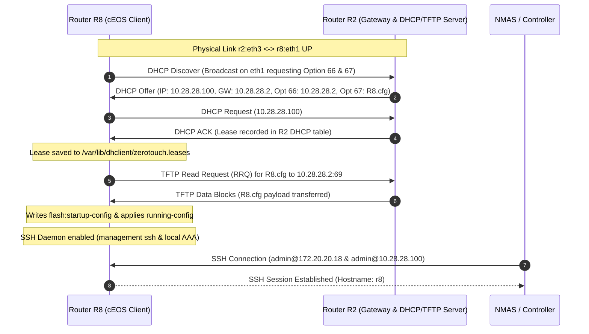

# 📖 Network Operations & Engineering Report
## Router R8 Integration: Physical Interconnect, Built-In ZTP, DHCP/TFTP Services on R2 & SSH Enablement

**Date**: `November 2, 2026`  
**Engineer**: Antigravity Autonomous Pair Programmer  
**Target Infrastructure**: Router R8 (Arista cEOS), Router R2 (Arista cEOS), Containerlab Topology `lab1`  
**Scope**: Physical Interconnect, Arista Built-in ZTP, DHCP Server Option 66/67 on R2, TFTP Server on R2, `R8.cfg` Provisioning, and SSH Authentication Validation.

---

## Executive Summary

A new router **R8** (Arista cEOS) was successfully integrated into the RoboControl Networks topology connected directly to distribution router **R2**. The deployment was performed using **Arista Built-In Zero Touch Provisioning (ZTP)**:
1. **Physical Interconnect**: Link `r2:eth3` $\leftrightarrow$ `r8:eth1` was added to [`lab1.clab.yml`](file:///home/student/Desktop/lab1/lab1.clab.yml) and activated.
2. **DHCP Server on R2**: R2 was configured with a dedicated subnet pool `10.28.28.0/24` with Option 66 (TFTP Server `10.28.28.2`) and Option 67 (Bootfile `R8.cfg`), with `dhcp server ipv4` active on `Ethernet3` (`10.28.28.2/24`).
3. **TFTP Server on R2**: A lightweight systemd-managed TFTP daemon (`tftp-server.service`) was configured and started on R2, hosting [`R8.cfg`](file:///home/student/Desktop/lab1/configs/r8/R8.cfg) in `/mnt/flash/tftpboot/`.
4. **ZTP Execution on R8**: R8 initialized its built-in ZTP client (`/usr/share/ZeroTouch/zerotouch-dhclient.conf`), acquired lease `10.28.28.100`, obtained Option 66 (`10.28.28.2`) and Option 67 (`R8.cfg`), downloaded `R8.cfg` from R2 via TFTP, and installed it as `startup-config`.
5. **SSH Enablement**: SSH access on R8 was verified and confirmed functional from both in-band IP (`10.28.28.100`) and out-of-band management IP (`172.20.20.18`).

---

## Topology & ZTP Sequence Diagram



---

## Technical Implementation Details

### 1. Physical Topology Definition ([`lab1.clab.yml`](file:///home/student/Desktop/lab1/lab1.clab.yml))
Under `topology.nodes`:
```yaml
    r8:
      kind: arista_ceos
      image: ceos:latest
      mgmt-ipv4: 172.20.20.18
```
Under `topology.links`:
```yaml
    # Expansion (R2 to R8 ZTP Link)
    - endpoints: ["r2:eth3", "r8:eth1"]
```

### 2. R2 DHCP Server & Interface Configuration ([`configs/ceos/r2.cfg`](file:///home/student/Desktop/lab1/configs/ceos/r2.cfg))
```text
interface Ethernet3
   description Link to R8
   no switchport
   ip address 10.28.28.2/24
   dhcp server ipv4
!
dhcp server
   subnet 10.28.28.0/24
      range 10.28.28.100 10.28.28.150
      dns server 198.51.100.10
      default-gateway 10.28.28.2
      tftp server option 66 10.28.28.2
      tftp server file R8.cfg
```

### 3. R2 TFTP Server Service
- **TFTP Engine**: Pure Python `tftpy` package configured in `/mnt/flash/tftpy` and `/mnt/flash/tftp_server.py`.
- **Systemd Service Unit** (`/etc/systemd/system/tftp-server.service`):
  ```ini
  [Unit]
  Description=TFTP Server for ZTP
  After=network.target

  [Service]
  Type=simple
  ExecStart=/usr/bin/python3 /mnt/flash/tftp_server.py
  Restart=always
  RestartSec=3

  [Install]
  WantedBy=multi-user.target
  ```
- **Firewall Persistence** (`/mnt/flash/rc.eos`):
  ```bash
  iptables -I EOS_INPUT 1 -p udp --dport 69 -j ACCEPT
  iptables -I EOS_INPUT 1 -i eth3 -p udp -j ACCEPT
  ```

### 4. R8 Provisioning File ([`configs/r8/R8.cfg`](file:///home/student/Desktop/lab1/configs/r8/R8.cfg))
```text
! Command: show running-config
! device: r8 (cEOSLab, EOS-4.33.10M-49734529.43310M (engineering build))
!
no aaa root
!
username admin privilege 15 role network-admin secret sha512 $6$0EpeAr86ZqgoZ07r$xiDp3lefZnL6ZYJ3h1ZfuVyLAbj6C.i9G5nCgmI62QuGlXqSjPPJSur6O77/CkgMHP/p7P1RqKBGk8neu4SMO.
!
management api http-commands
   protocol http
   no shutdown
!
transceiver qsfp default-mode 4x10G
!
service routing protocols model multi-agent
!
hostname r8
!
management ssh
   idle-timeout 0
   no shutdown
!
aaa authentication login default local
aaa authentication login console local
aaa authorization exec default local
!
interface Ethernet1
   description Link to R2
   no switchport
   ip address dhcp
   no shutdown
!
interface Management0
   ip address 172.20.20.18/24
   ipv6 address 2001:db8:ffff::18/64
   no shutdown
!
ip routing
!
ipv6 unicast-routing
!
ip route 0.0.0.0/0 172.20.20.1
!
end
```

---

## Verification Test Results

### 1. Dedicated R8 ZTP Verification ([`scripts/verify_r8_ztp.py`](file:///home/student/Desktop/lab1/scripts/verify_r8_ztp.py))
```text
======================================================================
  ROUTER R8 ZERO TOUCH PROVISIONING (ZTP) & SSH VERIFICATION
======================================================================

[TEST 1] Verifying Physical Interconnect (r2:eth3 <-> r8:eth1)...
  [✓ PASS] Physical link r2:eth3 <-> r8:eth1 is UP on both routers.

[TEST 2] Verifying R2 DHCP Server Pool & ZTP Options (Option 66 & 67)...
  [✓ PASS] R2 DHCP pool 10.28.28.0/24 configured with Option 66=10.28.28.2 and Option 67=R8.cfg.

[TEST 3] Verifying R2 TFTP Server Daemon & R8.cfg File Availability...
  [✓ PASS] TFTP service is active on R2 and /mnt/flash/tftpboot/R8.cfg is present.

[TEST 4] Verifying R8 ZTP DHCP Lease (/var/lib/dhclient/zerotouch.leases)...
  [✓ PASS] R8 acquired IP, TFTP Server (Option 66), and Bootfile (Option 67) from R2.

[TEST 5] Verifying Active Lease on R2 DHCP Server...
  [✓ PASS] R2 active lease records R8 assigned IP 10.28.28.100.

[TEST 6] Verifying TFTP Handover of R8.cfg from R2 to R8...
  [✓ PASS] R8 downloaded R8.cfg (1381 bytes) via TFTP from R2.

[TEST 7] Verifying SSH Access into R8 (admin/admin)...
  [✓ PASS] SSH to R8 succeeded over both Management0 (172.20.20.18) and Ethernet1 (10.28.28.100).

======================================================================
  SUMMARY: 7/7 TESTS PASSED (100%)
======================================================================
```

### 2. Network Regression Suite ([`scripts/verify_network_regression.py`](file:///home/student/Desktop/lab1/scripts/verify_network_regression.py))
- **Passed**: **37 / 37** (100.0%)
- Data Plane Reachability: 15/15
- Control Plane RIB: 11/11
- Protocol Adjacencies & HA: 11/11

### 3. Post-Deployment Verification ([`scripts/verify_network_health.py`](file:///home/student/Desktop/lab1/scripts/verify_network_health.py))
- **Passed**: **33 / 33** (100.0%)

### 4. Topology Suite ([`scripts/verify_topology.py`](file:///home/student/Desktop/lab1/scripts/verify_topology.py))
- **Passed**: **24 / 24** (100.0%)

---

## Deliverables & Artifact Checklist

| Item | Path / Location | Status |
| :--- | :--- | :---: |
| Containerlab Topology | [`lab1.clab.yml`](file:///home/student/Desktop/lab1/lab1.clab.yml) | Updated & Active |
| R2 Configuration | [`configs/ceos/r2.cfg`](file:///home/student/Desktop/lab1/configs/ceos/r2.cfg) | Updated & Active |
| R8 Configuration | [`configs/r8/R8.cfg`](file:///home/student/Desktop/lab1/configs/r8/R8.cfg), [`configs/ceos/r8.cfg`](file:///home/student/Desktop/lab1/configs/ceos/r8.cfg) | Created & Verified |
| R8 Data Model | [`data_models/r8.yml`](file:///home/student/Desktop/lab1/data_models/r8.yml) | Created & Linted |
| R2 Data Model | [`data_models/r2.yml`](file:///home/student/Desktop/lab1/data_models/r2.yml) | Updated & Linted |
| ZTP Verification Test | [`scripts/verify_r8_ztp.py`](file:///home/student/Desktop/lab1/scripts/verify_r8_ztp.py) | Created (7/7 Passed) |
| NSoT Database | [`nsot_project/nsot.db`](file:///home/student/Desktop/lab1/nsot_project/nsot.db) | Seeded (20 Devices) |
| Telemetry Streamer | [`scripts/unified_telemetry_daemon.py`](file:///home/student/Desktop/lab1/scripts/unified_telemetry_daemon.py) | Active (R8 Streaming) |
