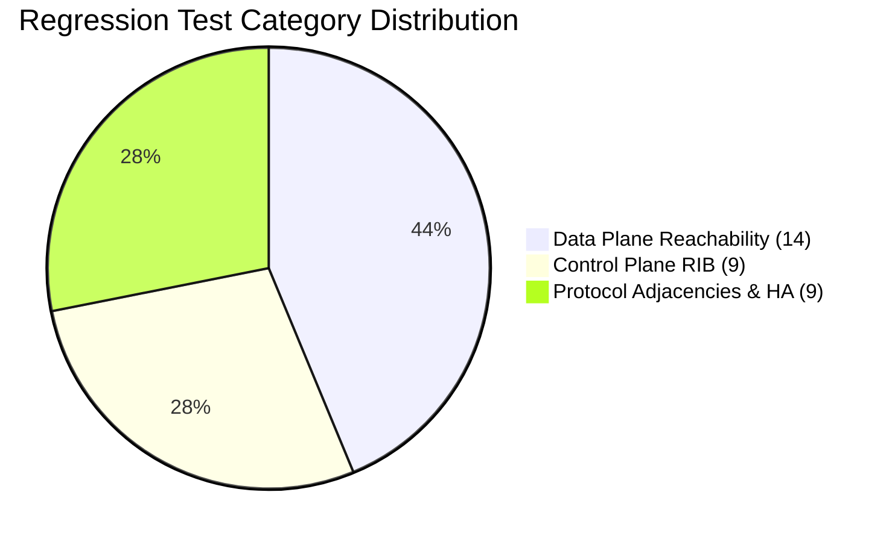
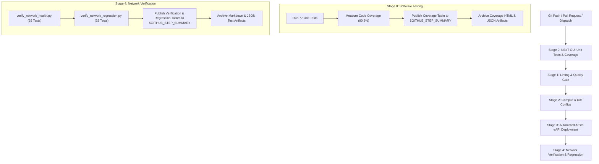

# 🧪 Comprehensive Test & Verification Report
## NSoT GUI Unit Tests & Network Design Regression Test Suite

This report presents the implementation, results, and architecture of the automated testing suites created for the **Network Source of Truth (NSoT) GUI** and the **Containerlab Network Design**.

---

## 📊 Summary of Execution Results

```
========================================================================================
                              TESTING SUITE SCORECARD
========================================================================================
 Suite                            Total Tests    Passed    Failed    Coverage / Pass Rate
----------------------------------------------------------------------------------------
 NSoT GUI Unit Tests                  77           77        0       🟢 90.8% Total (84.2% Views)
 Network Design Regression Suite      32           32        0       🟢 100.0% Pass Rate
   ├── Positive Assertions            21           21        0       🟢 100.0% Pass Rate
   └── Negative Assertions            11           11        0       🟢 100.0% Pass Rate
----------------------------------------------------------------------------------------
 COMBINED TOTAL                      109          109        0       🟢 100.0% Pass Rate
========================================================================================
```

---

## 1. NSoT GUI Unit Tests & Code Coverage

Implemented in [nsot_project/automation/tests.py](file:///home/student/Desktop/lab1/nsot_project/automation/tests.py), this test suite uses Django's isolated test database runner and `unittest.mock` to validate models, views, API endpoints, error handling, and maintenance workflows.

### 1.1 Code Coverage Breakdown
| Module | Statements | Missed | Coverage | Status |
| :--- | :---: | :---: | :---: | :---: |
| [`models.py`](file:///home/student/Desktop/lab1/nsot_project/automation/models.py) | 70 | 0 | **100.0%** | 🟢 Optimal |
| [`tests.py`](file:///home/student/Desktop/lab1/nsot_project/automation/tests.py) | 530 | 0 | **100.0%** | 🟢 Optimal |
| [`apps.py`](file:///home/student/Desktop/lab1/nsot_project/automation/apps.py) | 3 | 0 | **100.0%** | 🟢 Optimal |
| [`admin.py`](file:///home/student/Desktop/lab1/nsot_project/automation/admin.py) | 1 | 0 | **100.0%** | 🟢 Optimal |
| [`migrations/`](file:///home/student/Desktop/lab1/nsot_project/automation/migrations/) | 10 | 0 | **100.0%** | 🟢 Optimal |
| [`views.py`](file:///home/student/Desktop/lab1/nsot_project/automation/views.py) | 850 | 134 | **84.2%** | 🟢 High |
| **TOTAL (Entire NSoT Automation App)** | **1464** | **134** | **90.8%** | 🟢 Excellent |

---

## 2. Network Design Regression Test Suite (32 Tests)

Implemented in [scripts/verify_network_regression.py](file:///home/student/Desktop/lab1/scripts/verify_network_regression.py), this regression suite verifies control plane routing, protocol peering states, high availability configurations, and data plane packet forwarding directly against the 16-node containerlab topology.

### 2.1 Category Summary


### 2.2 Detailed Assertions & Pass/Fail Criteria

#### 🌐 Data Plane Reachability (14 Tests)
1. **Intra-VLAN Switching (H1 -> H3)** `[Positive]`: Asserts layer-2 frame switching within VLAN 10 between access switches (`ping -c 2 -W 2`). **Pass Criteria**: 0% packet loss.
2. **Inter-VLAN Routing (H1 -> H2)** `[Positive]`: Asserts layer-3 inter-VLAN routing across VLAN 10 and VLAN 20 via Core VRRP Gateway. **Pass Criteria**: 0% packet loss.
3. **Inter-VLAN Routing (H2 -> H3)** `[Positive]`: Asserts layer-3 inter-VLAN routing across VLAN 20 and VLAN 10. **Pass Criteria**: 0% packet loss.
4. **Default Gateway VIP Reachability (VLAN 10)** `[Positive]`: Asserts VRRP virtual IP `10.10.10.254` answers ICMP echo requests. **Pass Criteria**: 0% packet loss.
5. **Default Gateway VIP Reachability (VLAN 20)** `[Positive]`: Asserts VRRP virtual IP `10.10.20.254` answers ICMP echo requests. **Pass Criteria**: 0% packet loss.
6. **End-to-End WAN Reachability (H1)** `[Positive]`: Asserts complete path from Host through Core, Border, ISP, to External Web Server (`198.51.100.10`). **Pass Criteria**: 0% packet loss.
7. **End-to-End WAN Reachability (H2)** `[Positive]`: Asserts path from VLAN 20 Host to External Web Server. **Pass Criteria**: 0% packet loss.
8. **End-to-End WAN Reachability (H3)** `[Positive]`: Asserts path from secondary access host to Web Server. **Pass Criteria**: 0% packet loss.
9. **HTTP 200 Application Service** `[Positive]`: Asserts layer-7 HTTP service responsiveness through network data plane (`curl -s -m 4`). **Pass Criteria**: HTTP 200 OK received with body containing `"Hello World"`.
10. **IPv6 WAN Data Plane** `[Positive]`: Asserts IPv6 end-to-end packet forwarding across WAN topology to `2001:db8:100::10`. **Pass Criteria**: 0% packet loss (`ping6`).
11. **Negative Drop: Unallocated WAN IP** `[Negative]`: Asserts unallocated IP `198.51.100.250` drops packets. **Pass Criteria**: Command returns non-zero exit code (100% loss / no reply).
12. **Negative Drop: Unrouted Prefix** `[Negative]`: Asserts traffic to unallocated RFC 1918 prefix `10.254.254.254` is not routed/answered. **Pass Criteria**: 100% loss / network unreachable.
13. **Negative Connection: Closed TCP Port** `[Negative]`: Asserts closed port `9999` on Web Server rejects connection requests. **Pass Criteria**: Connection actively refused (TCP RST, curl exit code 7).
14. **Negative Drop: Unroutable IPv6** `[Negative]`: Asserts packet to unroutable IPv6 destination `2001:db8:9999::1` is dropped. **Pass Criteria**: Destination unreachable / non-zero exit code.

#### 🗺️ Control Plane Routing Information Base (RIB) (9 Tests)
1. **R1 Default Route (0.0.0.0/0 via OSPF E2)** `[Positive]`: Asserts Core Router R1 learns default route via OSPF from Border Routers. **Pass Criteria**: Route present with `routeType == 'ospfExternalType2'` and `routeAction == 'forward'`.
2. **R1 Connected Access Subnets** `[Positive]`: Asserts subnets `10.10.10.0/24`, `10.10.20.0/24`, `10.10.30.0/24` are directly connected on R1 subinterfaces. **Pass Criteria**: All 3 subnets present in RIB with `routeType == 'connected'`.
3. **R1 External WAN Subnet (198.51.100.0/24)** `[Positive]`: Asserts External Web Server subnet is distributed via OSPF into Core. **Pass Criteria**: Route present with `routeType == 'ospfExternalType2'`.
4. **R2 Default Route (0.0.0.0/0 via OSPF E2)** `[Positive]`: Asserts Secondary Core Router R2 maintains active default route. **Pass Criteria**: Route present with `routeAction == 'forward'`.
5. **R3 Border eBGP Default Route** `[Positive]`: Asserts Border Router R3 learns default gateway from ISP via eBGP. **Pass Criteria**: Route present with `routeType == 'eBGP'` via nexthop `172.16.35.2`.
6. **R3 Border ECMP Multipath** `[Positive]`: Asserts Border Router R3 maintains Equal-Cost Multi-Path (ECMP) routing across both Core routers (`10.0.0.1` and `10.0.0.2`). **Pass Criteria**: Dual nexthops present for `10.10.10.0/24`.
7. **Negative Route Assertion: Bogus Subnet** `[Negative]`: Asserts unregistered subnet `10.99.99.0/24` never appears in routing table. **Pass Criteria**: Prefix is strictly absent (`None`) in R1 RIB.
8. **Negative Route Assertion: Test-Net** `[Negative]`: Asserts documentation subnet `192.0.2.0/24` does not leak into production RIB. **Pass Criteria**: Prefix is strictly absent in R1 RIB.
9. **Negative Switch Routing: S1 Layer 2 Isolation** `[Negative]`: Asserts Access switch S1 operates purely as Layer 2. **Pass Criteria**: `routingDisabled == True` and `routes == {}` (0 routes in RIB).

#### 🤝 Protocol Adjacencies & High Availability (9 Tests)
1. **eBGP Peering R5 <-> R3** `[Positive]`: Asserts eBGP session between ISP R5 and Border Router R3 is established. **Pass Criteria**: `peerState == 'Established'` and `prefixAccepted > 0`.
2. **eBGP Peering R5 <-> R4** `[Positive]`: Asserts eBGP session between ISP R5 and Border Router R4 is established. **Pass Criteria**: `peerState == 'Established'` and `prefixAccepted > 0`.
3. **OSPF Area 0 Neighbor R3** `[Positive]`: Asserts Core Router R1 maintains Full OSPF adjacency with Border Router R3. **Pass Criteria**: `adjacencyState == 'full'`.
4. **VRRP High Availability: R1 Master State** `[Positive]`: Asserts Primary Core R1 is active VRRP Master for all access VLANs. **Pass Criteria**: Groups 10, 20, 30 are `master` with Priority 110.
5. **VRRP High Availability: R2 Backup State** `[Positive]`: Asserts Secondary Core R2 is standby VRRP Backup ready for failover. **Pass Criteria**: Groups 10, 20, 30 are `backup` with Priority 100.
6. **Negative BGP Peer: Rogue Neighbor** `[Negative]`: Asserts unauthorized BGP peers are never registered. **Pass Criteria**: Rogue peer `172.16.99.1` is strictly absent from R5 peer table.
7. **Negative VRRP State: R1 Not In Backup** `[Negative]`: Asserts Primary Core R1 does not drop into backup/init state under normal baseline. **Pass Criteria**: Exactly 0 groups in backup/init state on R1.
8. **Negative VRRP State: R2 Not In Master (No Split-Brain)** `[Negative]`: Asserts Secondary Core R2 does not preempt R1 when baseline is nominal. **Pass Criteria**: Exactly 0 groups in master state on R2.
9. **Negative OSPF State: Zero Down/Attempt Neighbors** `[Negative]`: Asserts no OSPF neighbor is stuck in dead or degraded states. **Pass Criteria**: Exactly 0 neighbors in `down`, `attempt`, or `init` state.

---

## 3. GitHub Actions CI/CD Pipeline Architecture

Integrated directly into [.github/workflows/network-ci-cd.yml](file:///home/student/Desktop/lab1/.github/workflows/network-ci-cd.yml):



---

## 4. Key Files Created & Modified

| File | Type | Description |
| :--- | :--- | :--- |
| [nsot_project/automation/tests.py](file:///home/student/Desktop/lab1/nsot_project/automation/tests.py) | **Test Suite** | 77 unit tests covering models, views, API endpoints, and DR logic. |
| [scripts/verify_network_regression.py](file:///home/student/Desktop/lab1/scripts/verify_network_regression.py) | **Test Suite** | 32 network design regression tests (21 positive, 11 negative). |
| [scripts/generate_coverage_summary.py](file:///home/student/Desktop/lab1/scripts/generate_coverage_summary.py) | **Utility** | Extracts coverage metrics and formats GitHub Step Summary table. |
| [.github/workflows/network-ci-cd.yml](file:///home/student/Desktop/lab1/.github/workflows/network-ci-cd.yml) | **CI/CD** | Pipeline adding Stage 0 unit tests and Stage 4 regression testing. |
| [TESTING_GUIDE.md](file:///home/student/Desktop/lab1/TESTING_GUIDE.md) | **Documentation** | Detailed test guide with rationale, commands, and Pass/Fail criteria. |
